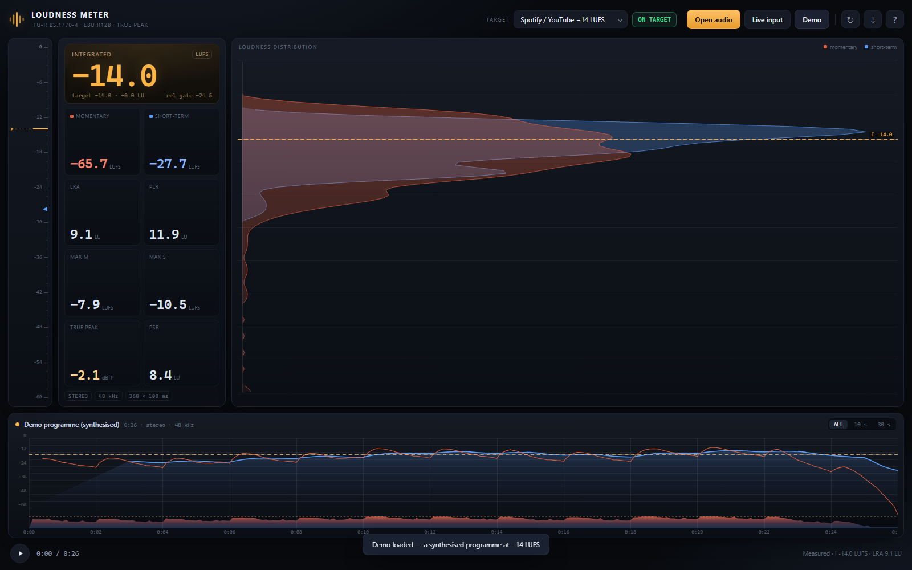

# Loudness Meter

A precision loudness meter in a single HTML file. Measured the way broadcasters and
streaming platforms measure: **ITU-R BS.1770-4** K-weighting and gating, **EBU R128**
integrated loudness and **EBU Tech 3342** loudness range, plus 4× oversampled true peak.

No server, no build step, no dependencies, no upload — audio never leaves the machine.



---

## Open it

| | |
|---|---|
| **Desktop shortcut** | Double-click **Loudness Meter** on the desktop. It starts a hidden local server, opens the page, and the server shuts itself down after 15 idle minutes. Everything works, including live input. |
| **File analysis** | Double-click `LoudnessMeter.html`. Everything works from `file://` except the microphone. |
| **Live input, manual** | Run `Start Loudness Meter.cmd` and use the page it opens at `http://localhost:8080`. |

Microphones are blocked on `file://` pages by every browser, which is the only reason a
shortcut has to start a server at all.

Drop a WAV/MP3/FLAC/OGG/M4A anywhere on the page, press **Open audio**, or press **Demo**
for a synthesised 26 s reference programme (−14.0 LUFS, −2.1 dBTP, LRA 9.1 LU).

---

## What it measures

| Readout | Meaning |
|---|---|
| **I — Integrated** | Gated loudness of everything measured. −70 LUFS absolute gate, then −10 LU relative gate (BS.1770-4 §2.4). |
| **M — Momentary** | 400 ms window, 100 ms hop. |
| **S — Short-term** | 3 s window. |
| **LRA** | Loudness range, EBU Tech 3342: P95 − P10 of short-term loudness after a −20 LU relative gate. |
| **True peak** | 4× polyphase oversampled inter-sample peak, dBTP, max across channels. |
| **Sample peak** | Highest sample value, dBFS (shown in the exported report). |
| **PLR** | Peak-to-loudness ratio: true peak − integrated. How much crest factor the mix keeps. |
| **PSR** | Peak-to-short-term ratio: true peak − max short-term. |
| **Max M / Max S** | Highest momentary / short-term value seen, with no gating. |

The distribution plot is a sideways histogram of every 100 ms block (momentary in red,
short-term in blue); the timeline plots both over time with the per-100 ms sample peak
along the bottom strip. The left ruler carries the same dB scale as the histogram, with
live markers for M, S and I.

## Targets

| Preset | Loudness | Ceiling |
|---|---|---|
| Spotify / YouTube | −14 LUFS | −1.0 dBTP |
| Apple Music | −16 LUFS | −1.0 dBTP |
| Podcast / spoken | −16 LUFS | −1.0 dBTP |
| EBU R128 broadcast | −23 LUFS | −1.0 dBTP |
| ATSC A/85 | −24 LUFS | −2.0 dBTP |
| Netflix | −27 LUFS | −2.0 dBTP |
| Club / DJ | −9 LUFS | −0.3 dBTP |

The badge shows `ON TARGET` inside ±0.3 LU, the signed delta inside ±1.0 LU (amber), and
red beyond that. A true peak above the ceiling always wins the badge (`TP +0.4`), and the
true-peak cell turns red.

## Working with it

- **Selection** — drag on the timeline to measure just that section (integrated, LRA,
  maxima, peak). Double-click or `Esc` clears it. Single click seeks.
- **Live input** — two sources behind one button: *Microphone / line input*, or
  **System audio**, which meters whatever the PC is playing (Audacity, a browser tab,
  Spotify). System audio goes through Chrome's share dialog: pick “Entire screen” and tick
  “Share system audio”.
- **Metadata** — edit or strip the container tags without touching the audio.
- **Auto-fix** — brings a file to the target: gain, then a look-ahead limiter at the
  ceiling, then re-measures and exports a 24-bit WAV. See below.
- **Window** — `ALL` / `10 s` / `30 s`; the short windows follow the playhead, or the end
  of the measurement when stopped.
- **Playback** — the transport plays the loaded file so you can hear what you are
  measuring; the playhead tracks the graph.
- **Export** — writes a plain-text report with every value, the target verdict, the
  selection figures and the method used.
- **LUFS / LKFS** — click the unit chip in the integrated card to switch nomenclature
  (identical units, different regional names).
- **Reset** — re-measures the loaded file, or clears the live accumulator.

| Key | Action |
|---|---|
| `Space` | play / pause |
| `O` | open file |
| `L` | live input |
| `R` | reset |
| `E` | export report |
| `F` | auto-fix panel |
| `M` | metadata editor |
| `?` | reference panel |
| `Esc` | close panel / clear selection |

---

## Fixing a file that misses the target

A quiet master is not rescued by the platform. YouTube turns loud material *down* to about
-14 LUFS, but it does not reliably turn quiet material up — a -20 LUFS upload simply plays
6 dB quieter than everything around it. **Auto-fix** rewrites the file to the target:

1. measure it (already done),
2. apply the gain that closes the gap,
3. run a 3 ms look-ahead limiter so true peak stays under the ceiling,
4. measure the result again with the same engine — the “after” column is measured, not
   predicted —
5. export a 24-bit WAV.

Because limiting costs loudness, a file that needs a lot of it lands slightly under target
(usually -14.1 rather than -14.0). That is honest: the alternative is to over-limit and
call it done.

Test files, target -14 LUFS / -1.0 dBTP:

| Input | Before | Gain | Limiter | After | Result |
|---|---|---|---|---|---|
| dynamic programme | -26.2 LUFS / -10.8 dBTP | +12.9 dB | 2.4 dB | **-14.05 LUFS / -1.05 dBTP** | 0.05 LU off |
| transient stress (click train) | -20.6 LUFS / +1.0 dBTP | +6.8 dB | 7.9 dB | **-14.01 LUFS / -1.05 dBTP** | 0.01 LU off |
| steady tone | -20.0 LUFS / -20.0 dBTP | +6.0 dB | none | **-14.00 LUFS / -14.01 dBTP** | exact |
| real master (too loud for -16) | -12.5 LUFS / -1.9 dBTP | -3.5 dB | none | **-16.00 LUFS / -5.4 dBTP** | exact |

What it cannot do: undo clipping that is already in the file, add dynamics back (limiting
only removes them), or encode MP3/AAC — browsers write WAV and FLAC only, so the export is
24-bit WAV at the measurement rate (48 kHz).

## Metadata

Masters carry tags nobody wrote on purpose: a `bext` originator with the workstation name, a
`LIST/INFO` artist left over from the DAW, XMP, ID3 from an earlier conversion. **Metadata**
(header button, or `M`) lists every chunk actually present in the file and lets you edit or
delete them.

- **Formats** — WAV (RIFF `INFO`, BWF `bext`, iXML, XMP, embedded ID3), MP3 (ID3v2.3/2.4,
  ID3v1, APE), FLAC (Vorbis comments, picture blocks).
- **Save copy** — writes the fields you typed and replaces only the tag chunk; `bext`, iXML
  and XMP are left alone, so a broadcast timecode survives an edit.
- **Strip all metadata** — removes every tag chunk, the BWF block, iXML, XMP and cover art.
- **Bit depth follows the source.** A 16-bit master comes back 16-bit (same file size, nothing
  to gain from padding), a 24-bit master comes back 24-bit. The dialog has a 16 / 24 / 32-bit
  float selector if you want to override it.
- **You choose where it goes.** Every export — tagged copy, stripped copy, auto-fix WAV, text
  report — opens the system Save dialog in Edge/Chrome, and the browser remembers that folder
  next time. Firefox has no such API, so it falls back to the Downloads folder.
- **The audio is never re-encoded.** The payload is copied byte for byte, so a WAV stays
  sample-identical and an MP3/FLAC keeps its original frames. Verified by decoding the file
  before and after and comparing PCM hashes.

WAV has no album-artist or ISRC slot in RIFF `INFO`, so those fields are not offered there —
the editor only shows fields the container can actually store.

## Accuracy

Measured against **ffmpeg's libebur128** (`ebur128=peak=true`) on eight signals, and for
true peak against an **exact 8× band-limited interpolation** (FFT zero-padding), which is
the mathematical reference rather than another meter's approximation.

| Signal | I (this) | I (ffmpeg) | LRA (this) | LRA (ffmpeg) | TP (this) | TP (exact) |
|---|---|---|---|---|---|---|
| 1 kHz sine, −20 dBFS | −19.99 | −20.00 | 0.00 | 0.00 | −20.00 | −20.00 |
| 1 kHz sine, −20 dBFS, 44.1 kHz | −19.99 | −20.00 | 0.00 | 0.00 | −20.00 | −20.00 |
| 1 kHz sine, −30 dBFS | −29.99 | −30.00 | 0.00 | 0.00 | −30.00 | −30.00 |
| 20 s @ −20 + 20 s @ −30 (LRA 10 LU) | −22.59 | −22.60 | 10.00 | 10.00 | −20.00 | −20.00 |
| Dynamic programme (quiet/mid/loud) | −26.17 | −26.20 | 18.42 | 18.40 | −10.80 | −10.77 |
| Real master, 90 s (country rock) | −12.51 | −12.50 | 6.34 | 6.30 | −1.94 | −1.87 |
| Click train / transients | −20.65 | −20.70 | 0.07 | 0.10 | 0.96 | 1.06 |
| 11.9 kHz tone (near Nyquist) | −0.57 | −0.60 | 0.00 | 0.00 | −0.92 | −0.92 |

**Worst deviation: 0.05 LU integrated, 0.04 LU LRA, 0.11 dB true peak.**

That last row is worth reading twice: for a tone just below Nyquist, ffmpeg reports
−0.40 dBTP, this meter reports −0.92 dBTP, and the exact interpolation says −0.915 dBTP.
libebur128's short interpolator overshoots there; a 0.9-amplitude sine cannot peak above
0.9. Away from Nyquist the two agree within 0.04 dB.

Reproduce with `node tests/verify.js` — it needs ffmpeg on `PATH`, the WAVs from
`python tests/gen_signals.py`, and `npm i` once for the Playwright UI tests. The
real-master row was cut from a local 90 s excerpt; it is not redistributed here.

## How it works

- **K-weighting** — the two biquads from BS.1770-4 (high shelf +4 dB @ 1.68 kHz, RLB
  high-pass @ 38.1 Hz) are re-derived by bilinear transform at the measured sample rate,
  so 44.1 kHz and 48 kHz both come out right. At 48 kHz the coefficients match the
  published table to 9 decimals.
- **Blocks** — 100 ms sub-blocks, summed into 400 ms momentary and 3 s short-term windows.
  This is exactly equivalent to a sliding window and makes one pass over the audio enough.
- **Gating** — absolute −70 LUFS, then relative −10 LU computed on the surviving blocks,
  averaging *powers* (not loudness values), as the recommendation requires.
- **LRA** — P10/P95 with linear interpolation between ranks, after the −20 LU gate.
- **True peak** — 4 phases × 24 taps, Blackman-windowed sinc, each phase normalised to
  unity DC gain. Samples more than 6 dB below the running peak are skipped: their
  interpolated value cannot become the maximum.
- **Performance** — 90 s of stereo 48 kHz measures in ~200 ms, including the true-peak
  pass. Longer files are processed in 2 s chunks with a progress bar, and the readouts fill
  in as it goes.

---

## Files

```
LoudnessMeter.html            the app — self-contained, ship this one
Loudness Meter.ico            desktop icon
Start Loudness Meter.cmd      serves the folder on :8080, visible console
src/loudness-core.js          BS.1770-4 measurement engine (browser + Node)
src/app.js                    UI, rendering, playback, export
src/styles.css                styling
src/template.html             shell with the three placeholders
build.js                      concatenates src/* -> LoudnessMeter.html
tools/serve.py                local server on :8787, exits after 15 idle min
tools/launch.vbs              what the desktop shortcut runs
tools/make_icon.py            draws Loudness Meter.ico
tools/install-shortcut.ps1    (re)creates the desktop shortcut
tests/verify.js               accuracy harness against ffmpeg + exact TP
tests/fix-test.js             auto-fix harness: target, ceiling, WAV round trip
tests/wav.js                  WAV reader used by both harnesses
tests/gen_signals.py          generates the reference WAVs
tests/exact_tp.py             exact true peak by FFT interpolation
tests/ui-test.js              headless UI run (Playwright) with screenshots
tests/ui-test2.js             export / window / reset checks
```

`src/` and `LoudnessMeter.html` are the same code; edit the sources and run `node build.js`
to regenerate the single file. `node_modules/` only appears after `npm i` and is only
needed for the Playwright UI tests — the meter itself has no dependencies at all.

## Notes and limits

- **Memory** — the whole file is decoded into RAM (about 11 MB per stereo minute at
  48 kHz, more in the browser). Very long files (1 h+) will be slow to decode.
- **Format support** is whatever the browser can decode: WAV, MP3, FLAC, OGG/Opus and
  M4A/AAC in Chrome, Edge and Safari; WAV/MP3/FLAC elsewhere.
- **Channel weights** follow BS.1770 for mono, stereo, 5.1 and 7.1 (LFE excluded,
  surrounds +1.5 dB). Other layouts are summed with unity gain.
- **Live input** is metered through a `ScriptProcessor` at the device rate; measurements
  are identical to file analysis, but there is no playback sync. System audio is a loopback
  of the whole output mix — it hears every sound the machine makes, not just the app you
  care about — and it is Chrome-only, because that is the only browser that offers it.
- **The local server** lives at `127.0.0.1:8787`, serves only this folder, and exits after
  15 minutes without a request. If it is already running, the shortcut just opens a tab.
- **Exact digital silence** reads as `−∞`, not a dash, and raises a small SILENT chip in the
  timeline header — a paused source should never look like a broken meter.
- Numbers are shown to 0.1 with no ballistics smoothing — what you see is the block value,
  not a decayed display.

## License

MIT — use it, fork it, ship it inside a commercial product. The only obligation is keeping
the copyright notice. The bundled `LoudnessMeter.html` carries the same notice in its header,
so a single copied file keeps its licence. See [LICENSE](LICENSE).
